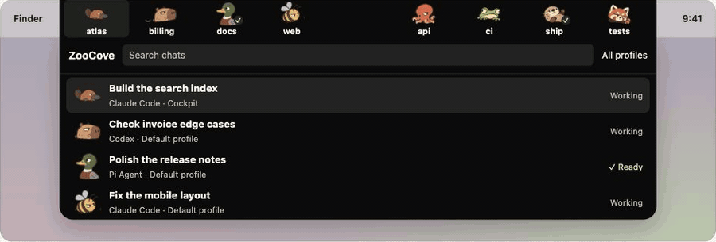

<p align="center"></p>

<h1 align="center">ZooCove</h1>

<p align="center">See which Codex, Claude Code, and Pi chats are working or ready from your MacBook notch.</p>

<p align="center">
  <a href="#install"></a>
  <a href="https://github.com/EuanTop/ZooCove/releases"></a>
  <a href="LICENSE"></a>
</p>

<p align="center"><a href="https://euantop.github.io/ZooCove/">Website</a> · <a href="#install">Download &amp; install</a> · <a href="README.zh-CN.md">简体中文</a> · <a href="CHANGELOG.md">Changelog</a></p>



## What it does

- **See what’s ready at a glance.** A doodle animal moves while a chat works. When the reply finishes, the animal settles and keeps a green check until you open the chat through ZooCove.
- **Find the right chat.** Click an animal or use a shortcut. Codex can jump to the matching desktop instance. Claude Code and Pi open a preview with a copyable command to resume that exact session.
- **Find and personalize chats.** Expand the notch to search by title, project, or chat ID. Pick a doodle or use a project image as the avatar for that chat.

ZooCove is a native macOS app built with AppKit and SwiftUI. It watches local session files and uses no ZooCove account or cloud service.

## Agent support

| Agent | Auto-detected profiles | Manual profile directory |
| --- | --- | --- |
| Codex | Default and Cockpit | `CODEX_HOME` |
| Claude Code | Default and Cockpit | `CLAUDE_CONFIG_DIR` |
| Pi Agent | Default | `PI_CODING_AGENT_DIR` |

[Cockpit Tools](https://github.com/jlcodes99/cockpit-tools) provides Codex and Claude Code profile locations. ZooCove reads each profile using that Agent’s own session format and generates a resume command for its directory.

The **v1.7.1 public download supports Codex**. Claude Code, Pi, and Cockpit Claude are available in the **1.8 series [from source](#build-from-source)**.

## Install

**Requires macOS 15 or later.** The universal build supports Apple silicon and Intel. A MacBook with a physical notch shows the compact animal strip. On other displays, open the switcher from the menu bar or with **⌃⌥J**.

1. Download `ZooCove.dmg` from [GitHub Releases](https://github.com/EuanTop/ZooCove/releases).
2. Open the disk image, drag **ZooCove** into **Applications**, then launch it.
3. Open Settings to choose the profiles you want to watch. In 1.8, choose the Agent before selecting a custom profile directory.

The first public preview uses ad hoc signing. macOS may block it on first launch because it has yet to be notarized. The release notes link to Apple's first-launch instructions. You can also [build a local copy](#build-from-source).

## Quick controls

| Action | Shortcut |
| --- | --- |
| Open or close the switcher | **⌃⌥J** |
| Jump to animals 1–9, ordered left to right | **⌃⌘1–9** |
| Cycle through visible animals | **⌃⌘Tab** |
| Select and preview a chat in the switcher | **↑ / ↓**, then **Return** |

When a destination can’t be identified reliably, ZooCove offers a resume command for that chat’s profile.

## Codex avatar skill

In ZooCove Settings, click **安装 Codex 头像技能** (Install Codex avatar skill), then start a new Codex chat or reopen the chat you want to customize. In that chat, enter “`$notchzoo-avatar` Use `assets/icon.png` as my ZooCove avatar,” using the path to your local image. The skill binds the image to that chat in its Codex profile. Enter “`$notchzoo-avatar` Restore my automatic avatar” to undo it.

## Build from source

Requires Swift 6 and macOS 15 or later.

```sh
swift test
./Scripts/build-app.sh
open -a "$PWD/dist/ZooCove.app"
```

To preview the [product page source](docs/index.html), run `python3 -m http.server 8000 --bind 127.0.0.1 --directory docs` and open `http://localhost:8000`. See the [release guide](RELEASING.md) for packaging, signing, and GitHub Pages.

### Diagnostics

```sh
dist/ZooCove.app/Contents/MacOS/ZooCove --diagnose
dist/ZooCove.app/Contents/MacOS/ZooCove --diagnose <chat-id>
./Scripts/sample-idle.sh "$(pgrep -x ZooCove)" 300
```

The diagnostic command lists profile types, folder names, and whether it finds a chat. The sampler reports ZooCove’s process counters. The [original doodle sheet](Design/animal-doodles-16.png) is the source for the in-app art.

## Contributing and license

Use [GitHub Issues](https://github.com/EuanTop/ZooCove/issues) for bugs and feature requests. Include your macOS version and steps to reproduce. Before submitting a code change, run `swift test`.

ZooCove uses the [MIT License](LICENSE). The website's Instrument Serif font is distributed under the [SIL Open Font License](docs/assets/OFL-InstrumentSerif.txt).
