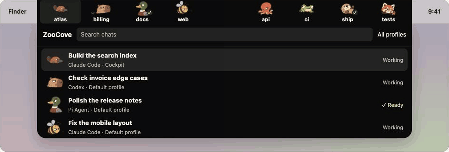

<p align="center"></p>

<h1 align="center">ZooCove</h1>

<p align="center">在 MacBook 刘海上看 Codex、Claude Code 和 Pi 哪条会话在跑、哪条已完成。</p>

<p align="center">
  <a href="#安装"></a>
  <a href="https://github.com/EuanTop/ZooCove/releases"></a>
  <a href="LICENSE"></a>
</p>

<p align="center"><a href="https://euantop.github.io/ZooCove/?lang=zh">产品首页</a> · <a href="#安装">下载与安装</a> · <a href="README.md">English</a> · <a href="CHANGELOG.md">更新记录</a></p>



## 能做什么

- **一眼看到会话状态。** 会话运行时，小动物会游动或振翅。回复完成后，动物停下来亮绿勾，直到你通过 ZooCove 打开那条会话。
- **打开对应的会话。** 点击动物或使用快捷键。Codex 可跳回对应的桌面实例，Claude Code 和 Pi 会在 ZooCove 内打开预览，并提供精确的终端恢复命令。
- **搜索会话，给它换个头像。** 展开刘海后，可以按标题、项目或会话 ID 搜索。每条会话都能选一只动物，也能用自己的项目图标。

ZooCove 使用 AppKit 和 SwiftUI 原生实现，读取本机会话文件并监听变化。使用 ZooCove 无需注册账号，也无需连接 ZooCove 云服务。

## 支持的 Agent

| Agent | 自动发现 | 可手动添加的目录 |
| --- | --- | --- |
| Codex | 默认和 Cockpit 实例 | `CODEX_HOME` |
| Claude Code | 默认和 Cockpit 实例 | `CLAUDE_CONFIG_DIR` |
| Pi Agent | 默认实例 | `PI_CODING_AGENT_DIR` |

[Cockpit Tools](https://github.com/jlcodes99/cockpit-tools) 提供 Codex、Claude Code 的实例位置，ZooCove 按对应 Agent 的格式读取会话，用原目录生成恢复命令。

**v1.7.1 公开下载版支持 Codex。** Claude Code、Pi 和 Cockpit Claude 可在 **[从源码构建的 1.8 系列](#从源码构建)** 中体验。

## 安装

**需要 macOS 15 或更新版本。** 通用安装包支持 Apple 芯片和 Intel Mac。有实体刘海的 MacBook 会显示动物栏。其他显示器可以用菜单栏入口或 **⌃⌥J** 打开会话面板。

1. 从 [GitHub Releases](https://github.com/EuanTop/ZooCove/releases) 下载 `ZooCove.dmg`。
2. 打开镜像，将 **ZooCove** 拖到「应用程序」，再启动它。
3. 在设置里选择要监听的实例。1.8 可以先选 Agent，再添加对应的本机实例目录。

首个公开预览版使用临时签名，尚未经过 Apple 公证，首次启动可能被 macOS 拦截。版本说明里有 Apple 的打开指引，也可以[从源码构建](#从源码构建)。

## 快捷操作

| 操作 | 快捷键 |
| --- | --- |
| 展开或收起会话面板 | **⌃⌥J** |
| 跳到从左到右的第 1–9 只动物对应的会话 | **⌃⌘1–9** |
| 按位置循环跳转 | **⌃⌘Tab** |
| 在面板选中并预览会话 | **↑ / ↓**，然后按 **Return** |

如果无法确认跳转目标，ZooCove 会提供对应实例的终端恢复命令。

## Codex 头像技能

在 ZooCove 设置里点「安装 Codex 头像技能」，然后新开一条 Codex 会话，或重新打开要换头像的会话。在会话里输入「`$notchzoo-avatar` 用 `assets/icon.png` 作为我的 ZooCove 头像」，把示例路径换成你本机的图片路径。技能会把图片绑到这条会话及其所属实例。想撤销时，输入「`$notchzoo-avatar` 恢复我的自动头像」。

## 从源码构建

需要 Swift 6 和 macOS 15 或更新版本。

```sh
swift test
./Scripts/build-app.sh
open -a "$PWD/dist/ZooCove.app"
```

运行 `python3 -m http.server 8000 --bind 127.0.0.1 --directory docs`，再打开 `http://localhost:8000`，即可预览[产品页源码](docs/index.html)。打包、签名和 GitHub Pages 的接入方式见[发版指南](RELEASING.md)。

### 诊断与采样

```sh
dist/ZooCove.app/Contents/MacOS/ZooCove --diagnose
dist/ZooCove.app/Contents/MacOS/ZooCove --diagnose <会话 ID>
./Scripts/sample-idle.sh "$(pgrep -x ZooCove)" 300
```

诊断命令输出实例类型、目录名和会话匹配结果。采样脚本读取 ZooCove 的进程计数。[涂鸦母图](Design/animal-doodles-16.png)用于生成应用内头像。

## 参与贡献与许可证

欢迎在 [GitHub Issues](https://github.com/EuanTop/ZooCove/issues) 报告问题或提建议。报告问题时，请附上 macOS 版本和复现步骤。提交代码前可以先运行 `swift test`。

ZooCove 使用 [MIT 许可证](LICENSE)。首页使用的 Instrument Serif 字体沿用 [SIL Open Font License](docs/assets/OFL-InstrumentSerif.txt)。
